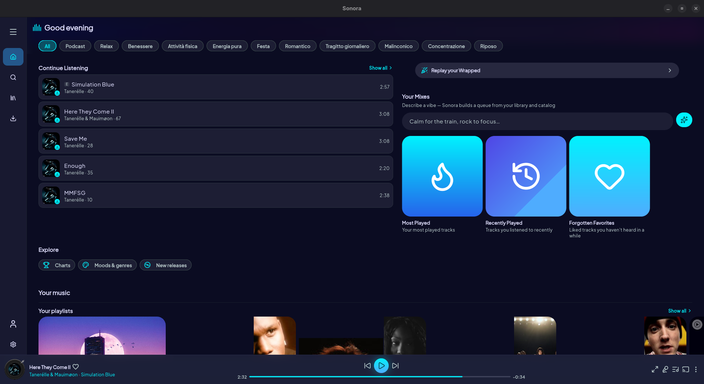
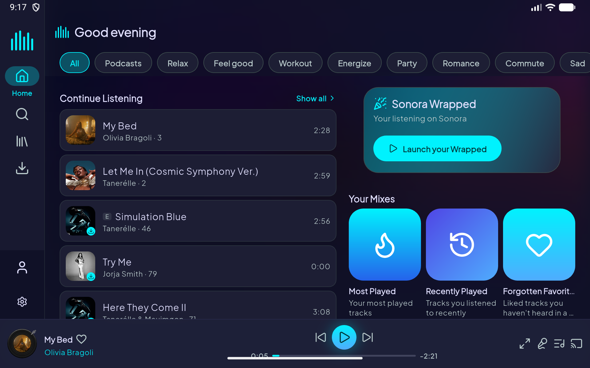
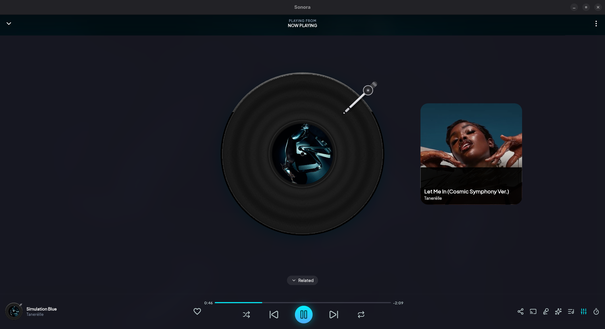
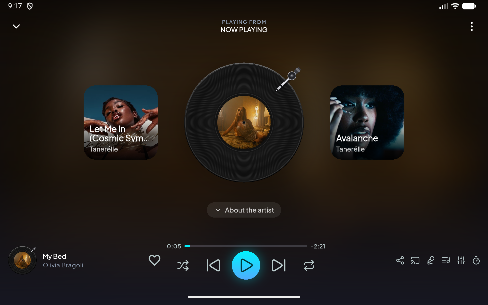
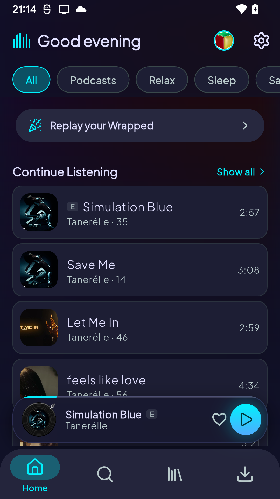
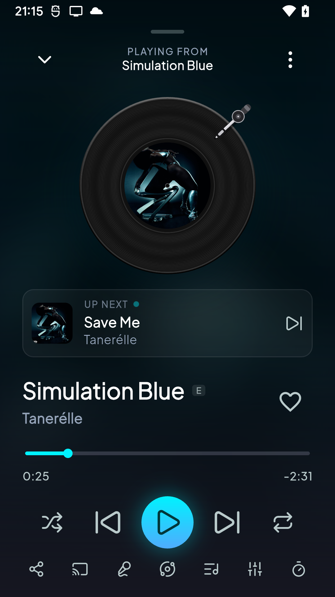
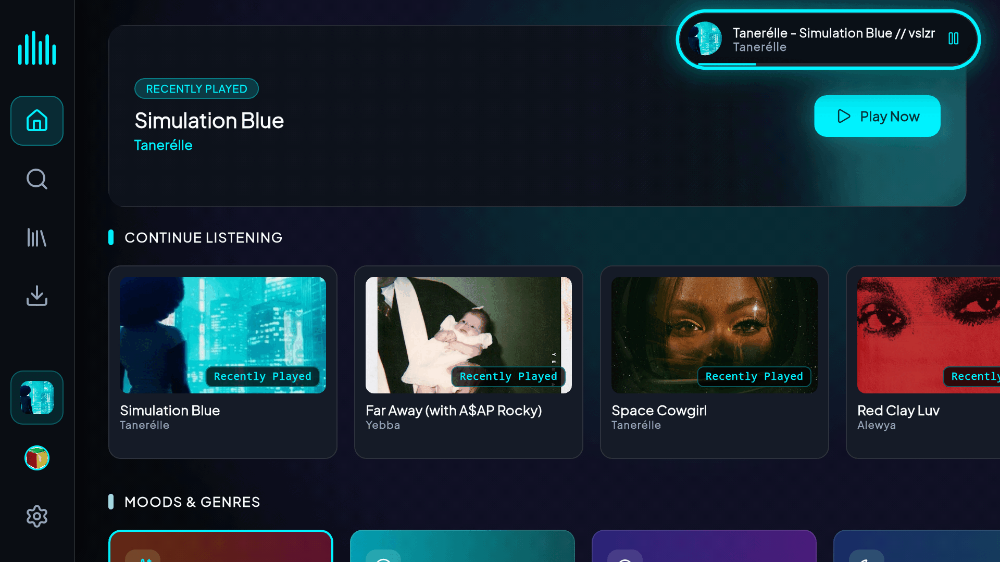
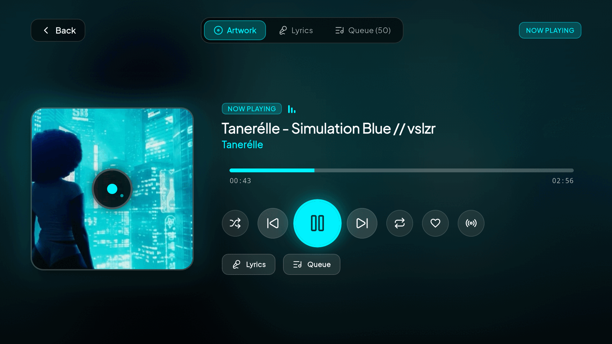

<p align="center">
  
</p>

<p align="center">
  🎵 A cross-platform music streaming app for YouTube Music, built with Flutter.
</p>

<p align="center">
  <a href="https://github.com/gmstyle/sonora/releases/latest"></a>
  <a href="LICENSE"></a>
  
  <a href="https://github.com/gmstyle/sonora/releases"></a>
</p>

Sonora uses **YouTube Music** as its data source and runs on **Android** (phone and tablet), **Android TV** (sideload) and **Linux desktop**, with one adaptive UI per form factor.

## 📸 Screenshots

| 🖥️ Desktop | 📱 Tablet |
|------------|-----------|
|  |  |
|  |  |

<details>
<summary>📲 Mobile screenshots</summary>

| Home | Player |
|------|--------|
|  |  |

</details>

<details>
<summary>📺 Android TV screenshots</summary>

| Home | Now Playing |
|------|-------------|
|  |  |

</details>

## ✨ Features

### ▶️ Playback

- Songs, albums, artists, playlists, music videos, podcasts and episodes from YouTube Music
- Music videos play as audio; background playback with a media notification
- Crossfade, 5-band equalizer (Android; Linux uses the system EQ), sleep timer
- Synced lyrics with optional translation
- Unplayable lead tracks are skipped automatically when an album or playlist starts
- Related songs in the player, Chromecast and DLNA casting
- Android Auto: Home, Library, Mixes, Explore, Charts & Moods, podcasts

### 📚 Library & offline

- Local library for likes, playlists, subscribed podcasts and saved episodes
- YouTube and Spotify playlist import, with manual re-sync for linked playlists
- Smart mixes from listening history, plus typed history
- Downloads and explicit offline mode, with a connectivity banner when the network drops

### 🔐 YouTube account

- **Optional sign-in**: use Sonora anonymously out of the box, or sign in with your YouTube Music account for personalized Home shelves, Quick Picks, and age-gated tracks
- **Android**: sign in directly inside the app via WebView
- **Linux & Android TV**: link your account from a signed-in Android phone over local Wi-Fi by scanning an encrypted QR code (verified with a 6-digit confirmation code)

### 🧭 Explore

- Charts, Moods & Genres, New Releases
- Artist pages with the full album, single and video lists
- Podcast, episode, user and channel pages
- Search across songs, videos, podcasts and users

### 🖥️ Desktop & extras

- Adaptive layouts (phone, tablet, wide) and a standalone 10-foot Android TV UI with D-pad navigation
- Sonora Pulse themes: light, dark, AMOLED
- Linux tray and MPRIS; auto-update from GitHub Releases with in-app release notes
- Headless CLI, backup/restore, P2P library sync over Wi-Fi, Sonora Wrapped, English and Italian

## 📱 Supported Platforms

| Platform | Requirement |
|----------|-------------|
| 🤖 Android | Android 11+ (API 30), phone and tablet |
| 📺 Android TV | Sideload APK, 10-foot UI |
| 🐧 Linux | x64 desktop |

Windows, macOS and iOS are not planned.

## ⬇️ Download

Grab the latest build from [GitHub Releases](https://github.com/gmstyle/sonora/releases/latest).

| Platform | File | Notes |
|----------|------|-------|
| 🤖 Android | `app-release.apk` | Universal, signed |
| 🤖 Android | `app-arm64-v8a-release.apk`, `app-armeabi-v7a-release.apk` | Smaller per-ABI builds |
| 📺 Android TV | Same APKs | Sideload, Leanback launcher |
| 🐧 Linux | `sonora-linux-x64.tar.gz` | Portable, with install scripts |
| 🐧 Linux | `.deb` / `.rpm` | Debian/Ubuntu, Fedora/RHEL |

## 🚀 Getting Started

### Prerequisites

- Flutter 3.47+ (stable channel)
- Android Studio for Android builds

<details>
<summary>Linux build dependencies</summary>

```bash
sudo apt install clang cmake ninja-build pkg-config libgtk-3-dev liblzma-dev \
  libmpv-dev libayatana-appindicator3-dev libx11-dev libxi-dev
```

</details>

### Build from source

```bash
git clone https://github.com/gmstyle/sonora.git
cd sonora

flutter pub get
dart run build_runner build --delete-conflicting-outputs
flutter gen-l10n
```

Run it:

```bash
flutter run
```

Release builds:

```bash
flutter build apk --release
flutter build linux --release
```

### ⌨️ Headless CLI

```bash
curl -fsSL https://raw.githubusercontent.com/gmstyle/sonora/dev/install.sh | bash
sonora search "the beatles" --limit 5
```

See [CLI documentation](docs/CLI.md) for every command and option.

## 🛠️ Development

Stack: Flutter 3.47+, Riverpod, go_router, Drift, just_audio, [dart_ytmusic_api](https://github.com/gmstyle/dart_ytmusic_api), youtube_explode_dart.

Architecture, database, audio engine and the release pipeline are documented in [SONORA-DEV-DOCS.md](docs/SONORA-DEV-DOCS.md); the UI contract is in [DESIGN.md](docs/DESIGN.md).

- Bugs and feature requests: [GitHub Issues](https://github.com/gmstyle/sonora/issues)
- Pull requests are welcome

Checks before opening a PR:

```bash
dart format .
flutter analyze
flutter test --exclude-tags integration
```

Regenerate after a Drift schema or localization change:

```bash
dart run build_runner build --delete-conflicting-outputs
flutter gen-l10n
```

## ❤️ Support

If Sonora is useful to you, a small donation is always appreciated.

[](https://paypal.me/gmstyle)

## 📄 License

Distributed under the MIT License. See [LICENSE](LICENSE) for more information.

### Disclaimer

Sonora is an independent project and is not endorsed by YouTube or Google. It does not collect personal data and does not host, distribute, or sell copyrighted material. All content belongs to the respective owners. Sonora is for educational purposes only. The developer does not encourage illegal activity and is not responsible for misuse of the software.
